<p align="center">
  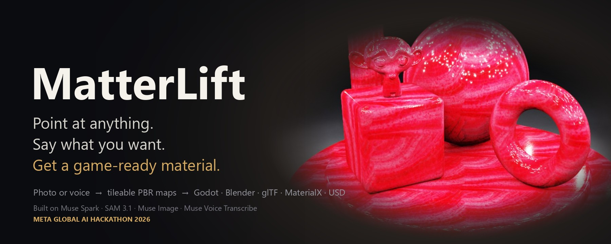
</p>

<p align="center">
  <b>Track:</b> Indie Developer<br>
  <b>Problem statement:</b> Build for Your World<br>
  <b>Bonus targeted: Creative Build</b><br>
  <sub>a path tracer in the browser written during the hackathon (WebGPU ReSTIR), a 3D scene modelled in code, and a voice-to-material workflow that ends in Godot and Blender</sub><br>
  <sub>Built from scratch Nov 1–4; Live RT ports the design of my earlier OptiX tracer.</sub>
</p>

<p align="center">
  <a href="https://matterlift.vercel.app"></a>
  <a href="https://youtu.be/-MqR3USLmUE"></a>
  <a href="#60-second-judge-path"></a>
  <a href="#how-each-meta-model-works-in-matterlift"></a>
  <a href="#gallery"></a>
</p>

<p align="center">
  <a href="https://github.com/falcon123212/matterlift/actions/workflows/tests.yml"></a>
  
  
  
  
</p>

<p align="center">
  <b><a href="https://matterlift.vercel.app">Live demo</a></b> ·
  <a href="#gallery">Gallery</a> ·
  <a href="#how-each-meta-model-works-in-matterlift">The 4 Meta models</a> ·
  <a href="#real-photos-six-objects-from-a-desk">Real photos</a> ·
  <a href="#how-it-works">How it works</a> ·
  <a href="#tests-and-benchmarks">Tests</a> ·
  <a href="#run-it">Run it</a> ·
  <b><a href="https://youtu.be/-MqR3USLmUE">Video</a></b>
</p>

<br>

<p align="center">
  <a href="https://youtu.be/-MqR3USLmUE">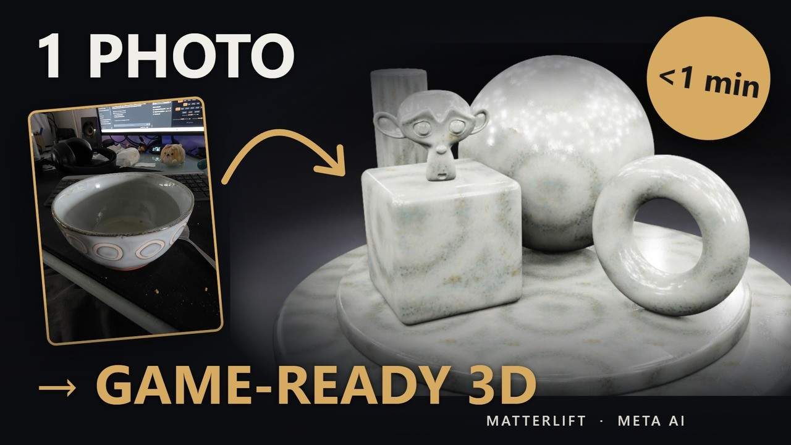</a>
  <br>
  <sub>▶ <a href="https://youtu.be/-MqR3USLmUE"><b>Watch the 3-minute demo</b></a>: one photo of a bowl, a game-ready material in under a minute, every Meta call live on screen.</sub>
</p>

<br>

From a photo or a sentence to a game-ready material: show a real surface, say what you want, get a
tileable PBR material (albedo, normal, height, AO, roughness, metallic, thickness, ORM, glTF) ready
for Godot, Blender, Unity or Unreal. Open source, built on Meta's models (Muse Spark, Muse Image,
SAM 3.1, Muse Voice Transcribe).

## See it in action

<table>
  <tr>
    <td width="50%" align="center"><a href="https://youtu.be/-MqR3USLmUE">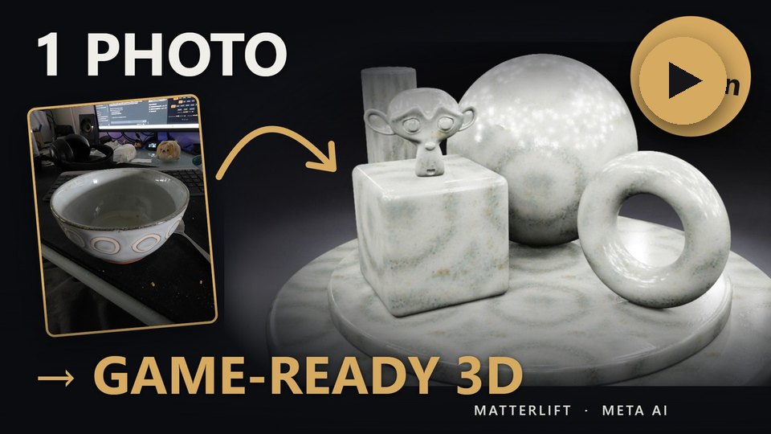</a><br><b>The 3-minute demo</b><br><sub>A photo of a bowl, every step on screen</sub></td>
    <td width="50%" align="center"><a href="https://youtu.be/BPpDhytLlfs">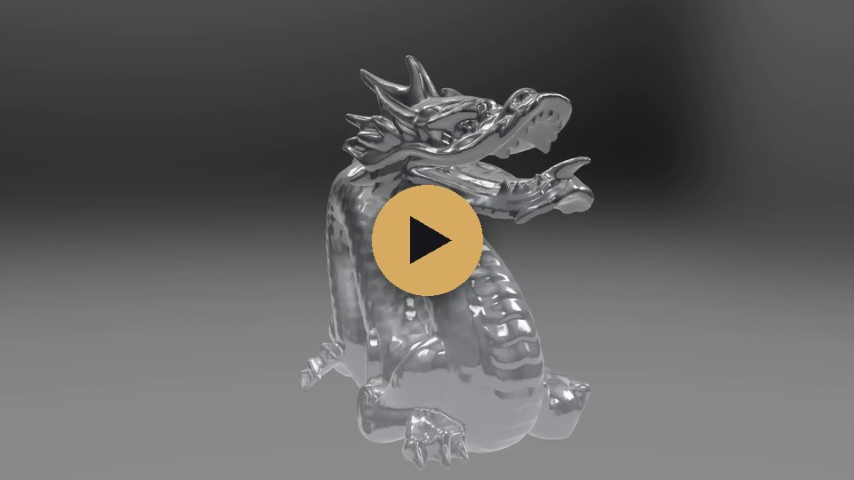</a><br><b>A diamond, from two words</b><br><sub>Spark sets transmission and IOR 2.4</sub></td>
  </tr>
  <tr>
    <td width="50%" align="center"><a href="https://youtu.be/tEU3NPhObLY">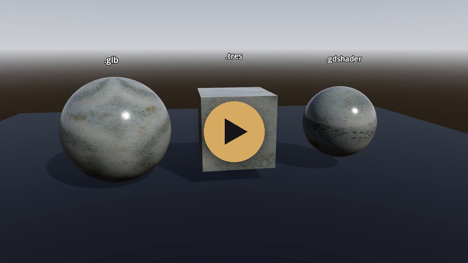</a><br><b>Straight into Godot 4</b><br><sub><code>.glb</code> · <code>.tres</code> · live <code>.gdshader</code></sub></td>
    <td width="50%" align="center"><a href="https://youtu.be/5K5PUd57xCg">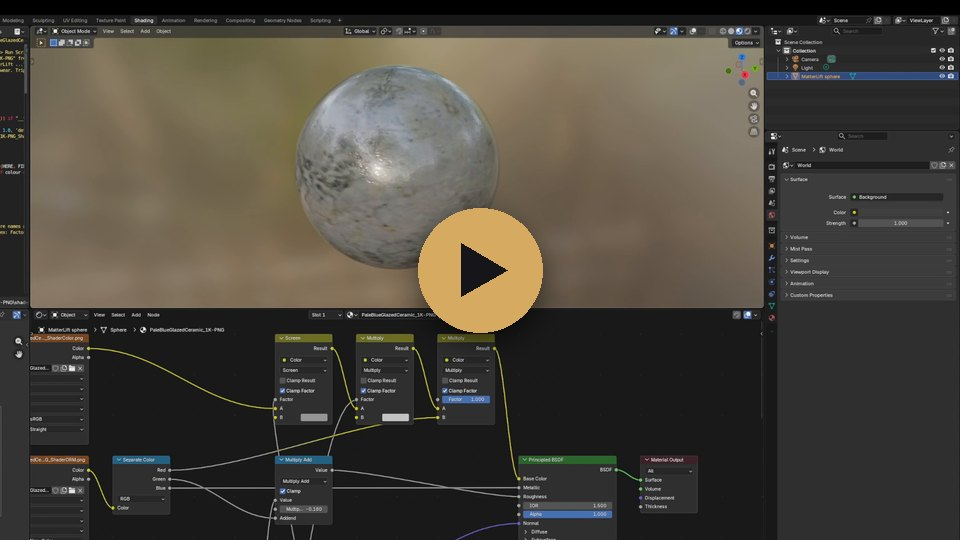</a><br><b>Straight into Blender</b><br><sub>A node tree with live sliders</sub></td>
  </tr>
</table>

<p align="center"><sub>Live RT (path tracing) is tested on Chrome on Windows with an NVIDIA GPU only.</sub></p>

<p align="center">
  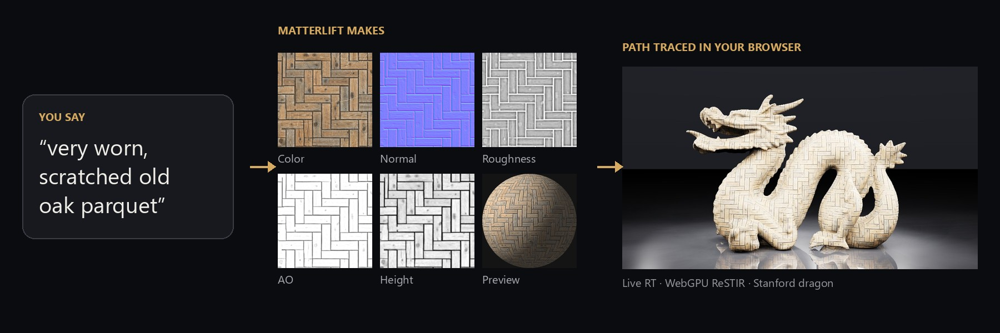
</p>

<p align="center">
  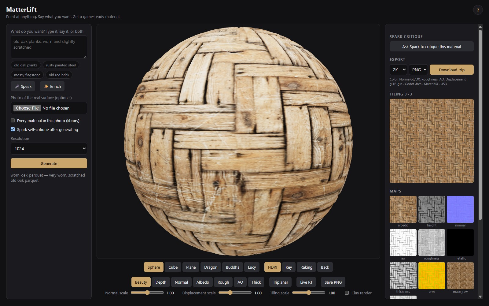
  <br>
  <sub>The page: "very worn, scratched old oak parquet" on the Study, the tiled 3×3 seam check, every map and the export.</sub>
</p>

## Gallery

Six materials made from a sentence alone: five in **Live RT** (path traced in the browser, WebGPU),
the diamond in the 3D preview, all on the **Study**, the scene the live demo shows. Each one is in [`samples/export/`](samples/export) exactly as **Download .zip**
gives it (512 px PNG): maps, `.glb`, Godot `.tres` and shader, MaterialX, USD, Blender script, all
passing the Khronos glTF validator, MaterialX, USD and Godot 4. Prompts typed in French are shown translated: MatterLift
takes requests in any language Spark reads.

| | | |
|---|---|---|
| 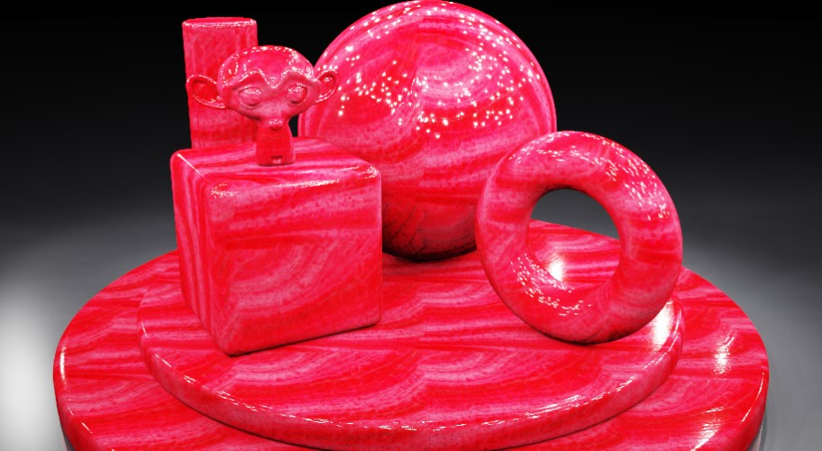 | 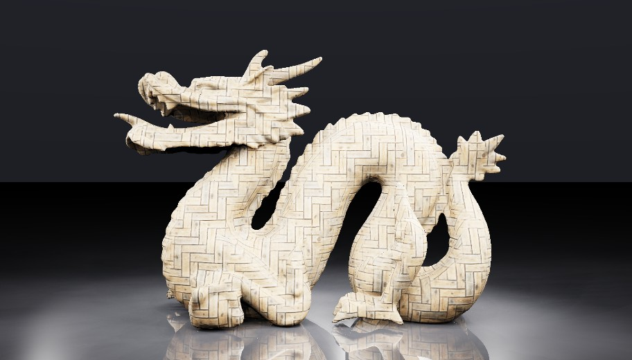 |  |
| **"a ruby"**: transmission, IOR 1.77, clearcoat, and a thickness map ([export](samples/export/Ruby_512-PNG)) | **"very worn, scratched old oak parquet"** ([export](samples/export/OldWornOakParquet_512-PNG)) | **"Century-old grey-beige weathered limestone, raw matte finish, pores, fine cracks and visible mortar joints…"**: a detailed brief, down to 60×40 cm blocks ([export](samples/export/AgedLimestoneBlocks_512-PNG)) |
| 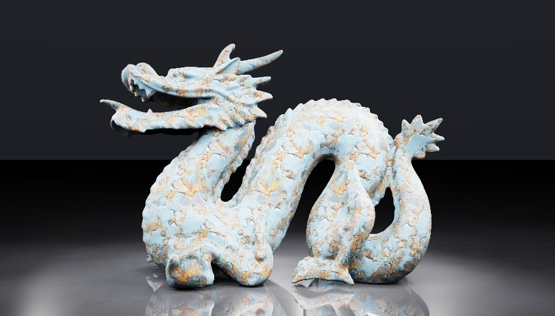 | 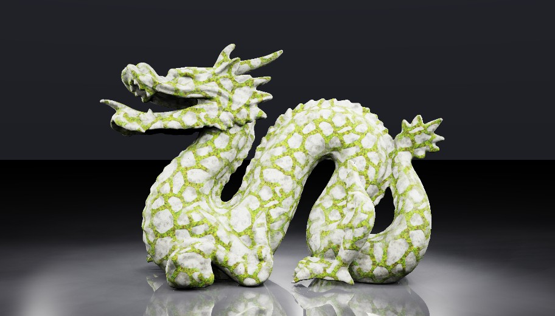 | [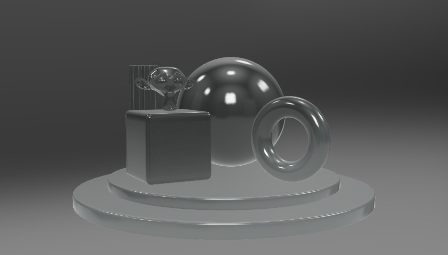](https://youtu.be/BPpDhytLlfs) |
| **"rusty painted steel plate, orange rust patches with bare grey metal and flaking blue paint"**: metal only where the paint is gone ([export](samples/export/RustyPaintedSteel_512-PNG)) | **"mossy flagstone path, irregular grey stones with green moss in the joints"** ([export](samples/export/MossyFlagstonePath_512-PNG)) | **"a diamond"**: Spark set full transmission and IOR 2.4 by itself. Shown in the 3D preview, since Live RT does not trace transmission yet ([export](samples/export/Diamond_512-PNG) · [▶ watch it being generated](https://youtu.be/BPpDhytLlfs)) |

## Why MatterLift

MatterLift is an open-source material and shader extractor: show a photo, say what you want, get a
material ready for Godot, Blender, Unity or Unreal.

- **The problem.** A unique material takes time, technical-artist know-how and a paid tool. Free libraries
  give everyone the same materials.
- **For whom.** Indie developers and modders (over 19,000 games released on Steam in 2025
  [[1]](https://www.gamingonlinux.com/2025/12/over-19000-games-have-released-on-steam-in-2025-with-nearly-half-seeing-fewer-than-10-reviews)),
  beginner 3D artists, students; and VFX pre-production teams exploring a look before production.
- **Why now.** Substance 3D Texturing costs US$249.88 a year and the full Collection US$599.88
  [[2]](https://blog.adobe.com/en/publish/2025/02/20/substance-3d-innovations-pricing-updates); in
  France the Collection is €57.47 a month incl. VAT, €95.99 a month per seat for teams
  [[2b]](https://www.adobe.com/fr/products/substance3d/plans.html). Meanwhile an estimated 40% of 2025 Steam
  releases earned less than $100 [[3]](https://mp1st.com/news/40-of-steam-games-in-2025-earned-less-than-100).
  Teams are shrinking: 28% of game workers were laid off in the past two years (GDC 2026 State of
  the Game Industry [[4]](https://gdconf.com/article/gdc-2026-state-of-the-game-industry-reveals-impact-of-layoffs-generative-ai-and-more/)),
  and open-source Godot grew from 0.9% to 7.1% of the releases GameDiscoverCo tracks, 2020 to 2025
  [[5]](https://newsletter.gamediscover.co/p/hows-pc-game-engine-usage-changing).
- **How.** Muse Spark frames the surface and writes the material plan, SAM 3.1 masks it precisely,
  Muse Image paints the tileable texture, Muse Voice Transcribe takes spoken requests. MatterLift
  computes the PBR maps, the shaders, the lit preview and the export, and Spark critiques the
  result itself.
- **Gain.** Time: about 1 min from a sentence at 512 px, 1.5 min from a photo at 1K (measured on the free live demo), instead of
  hours. Money: pay-per-use API calls instead of a subscription. Control: materials taken from your
  own photos, exported in standard formats (glTF, MaterialX, USD, Godot, Blender).

## 60-second judge path

1. **Ask.** Open the [live demo](https://matterlift.vercel.app), type
   `old oak planks` or press **Speak**, then **✨ Enrich** (Spark fixes and completes the request)
   and **Generate**. About 1 min at 512 px; the first request after a pause also wakes the API.
2. **Look.** Turn the sphere under **Raking** light, check the seams in **Tiling 3×3**, switch the
   passes (Depth, Normal, Albedo, Rough, AO). Try it on the **Study** (MatterLift's own scene: a
   plinth, a sphere, a rounded cube with Suzanne, a torus and a fluted column), tick **Real-world
   scale**, or open **Live RT**: that scene path traced in the browser (WebGPU; tested on Chrome on Windows with an NVIDIA
   GPU only, see [Live RT limits](#live-rt-limits)) with the same material. With a photo, MatterLift
   first shows what it understood: the surface SAM masked and the square it sampled, before
   generating anything.
3. **Use it.** **Download .zip**: ambientCG-style maps, a glTF `.glb`, Godot `.tres` and
   `.gdshader`, MaterialX, USD and a Blender script. Drop the `.glb` into Godot, Blender or any
   glTF viewer ([▶ in Godot 4](https://youtu.be/tEU3NPhObLY): the `.glb`, the `.tres` and the live `.gdshader`; [▶ in Blender](https://youtu.be/5K5PUd57xCg), with live sliders).

## How each Meta model works in MatterLift

Four Meta models, ten jobs. Every call goes to the Meta Model API (`https://api.meta.ai/v1`) from
one file, [`matterlift_api/meta_client.py`](matterlift_api/meta_client.py); pbrforge (our numpy
code) does everything between the calls. Nothing else calls an AI model at runtime.

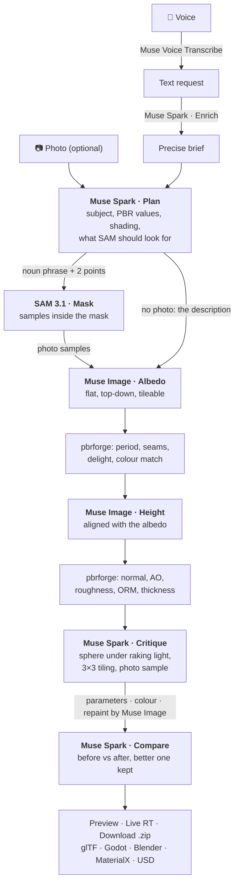

| Model | Its jobs in MatterLift | Endpoint | Measured (median) |
|---|---|---|---|
| **Muse Spark** `muse-spark-1.3` | Enrich a request · plan the material from request + photo (finds the subject from the framing) · critique · compare before/after · list a room's materials | `/chat/completions`, JSON mode | plan 21 s (19 to 30 s) · enrich 17 to 20 s · critique, fix and compare 85 s |
| **SAM 3.1** `sam-3.1` | Mask the surface Spark named, or the object under the user's clicks | `/responses` | 2.5 s |
| **Muse Image** `muse-image-1.0` | Paint the albedo from the photo samples (or from text) · paint the height map from that albedo · repaint what the critique flags | `/images/edits`, `/images/generations` | albedo 10 s · height 12 s |
| **Muse Voice Transcribe** `muse-voice-transcribe-1.0` | Spoken requests, in French or English | `/asr/transcribe` | 1.8 s for a 5 s request |

<sub>Medians of the 6-photo test on the live site, Nov 4 (see Real photos below); enrich and transcribe from the live calls of the video's voice take.</sub>

### Muse Spark: the technical artist

1. **Enrich** (`POST /enhance`, the ✨ button, and automatically after a spoken request). Spark gets
   the request (and the photo if there is one) and returns one sentence of at most 25 words in the
   same language: speech-recognition slips fixed ("enchaîne" → "en chêne"), and only colour, finish
   and wear added when missing, never a species, pattern or object the user did not ask for. Live,
   from the video: *"Old oak planks, worn and slightly scratched."* → *"old brown oak planks with
   matte finish, worn and slightly scratched"*. Undoable in one click.
2. **Plan** (inside `POST /understand` and `POST /materials`). Spark sees the request and the photo
   (1024 px) and writes the whole material as JSON: `texture_prompt` (what Muse should paint),
   `subject` and `subject_reason`, `sam_prompt` plus two alternative names and two points on a clean
   area (for SAM), roughness and its variation, metallic, relief and normal strength, the micro-detail
   kind and strength, wear, the real-world tile size, and the shading lobes (transmission, IOR,
   clearcoat, sheen, subsurface, anisotropy). With no words, it reads the photo as its author framed
   it: the subject is what is centred, in focus and closest; the table under it is context. The bowl
   in the video: subject *"ceramic bowl"*, because *"the bowl is centered, close to the camera and
   fills most of the frame"*, `sam_prompt` *"bowl"*, roughness 0.15, clearcoat 0.9. "a diamond" gets
   transmission 1 and IOR 2.4 by itself.
3. **Critique** (`POST /materials/{id}/critique`, on by default after each generation). MatterLift
   renders one review sheet: the material on a sphere under a low raking light, the texture tiled 3×3
   and the photo sample. Spark scores it 1 to 10 and says what to change, each with its own tool:
   parameters (relief, roughness, wear, detail) are re-derived at once with no new image; colour is
   matched to the photo in CIELAB, deterministically; only faults in the colour texture itself (baked
   light, a standout motif, seams) go back to Muse Image as one repaint instruction.
4. **Compare**. The version before and the fixed one, stacked in one image: Spark scores both and
   picks the better; that one is kept, and the UI shows both. The bowl: *"Large cream quatrefoil
   motifs form an obvious repeating grid unlike the plain glaze in the photo"* → Muse repainted it
   plain, 4/10 → 6/10, fixed version kept. With nothing to fix (8/10 for the spoken oak in the video),
   the material stays as it is.
5. **Library** (`POST /libraries`). On a room photo Spark lists up to 8 materials with two points
   each, or plans the one under each click of the user.

If Spark's JSON is empty or cut (its reasoning used the budget), the call is retried once with three
times the tokens; a field with a wrong type falls back to its default and numbers are clamped
(`MaterialPlan.lenient`), so a bad answer never stops a run.

### SAM 3.1: the mask

- **Asked:** the photo (1024 px) and Spark's noun phrase (*"bowl"*) as a concept prompt: SAM returns
  every instance. Or point prompts, up to 16 objects in one pass, when the user clicks surfaces, and
  as a fallback.
- **Answers:** per instance a box and a mask, as text tokens; we request `one_bit` masks and decode
  them with `matterlift_api/sam_mask.py`, a port of Meta's `@meta-sam/parser`.
- **MatterLift then:** keeps the instance under Spark's points, takes the largest rectangle inside the
  mask (up to 3:1, so a countertop strip still works) and up to two more away from it, so whatever lies
  on the surface stays out of the samples. The page shows the photo with the mask and the sampled
  squares *before* anything is painted.
- **If SAM finds nothing:** Spark's two alternative names, then Spark's points as SAM point prompts,
  then a square around the points, then the material is painted from Spark's description alone, and
  the UI says which one happened.

### Muse Image: the painter

- **Albedo from the photo:** `/images/edits` with up to three samples and *"Turn these photos … into
  one {Spark's texture_prompt}. Seamless tileable PBR albedo texture, orthographic top-down view …
  flat even diffuse lighting, no shadows, no specular highlights … Keep the pattern elements as large
  relative to the frame as they appear in the first sample."* The photo's scale survives: a kitchen's
  octagonal floor tiles stay octagons.
- **Albedo from text:** `/images/generations` with the same description and suffix.
- **Height map:** `/images/edits` on the cleaned albedo, *"convert this texture into its grayscale
  height map … joints, gaps and cracks black, raised surfaces white … keep every edge exactly
  aligned"*. Against a real scanned displacement (ambientCG Bricks113A) it reaches r = 0.71, where
  the usual luminance trick gives −0.24; normals and AO are built from it.
- **Repaint:** Spark's fix instruction on the current albedo (*"Remove the cream quatrefoil motifs
  and leave plain pale-blue glaze"*).
- **Settings that matter:** PNG out, `reasoning_strength: "low"` (about twice as fast, and a unique
  1600 px image where "high" repeats one 800 px tile 2×2), web and image search off.
- **pbrforge cleans its output:** finds and crops the 2×2 repetition Muse often paints, removes seams
  (periodic component + minimum-error cut), delights, matches the colours back to the photo.
- **If it fails:** from the photo → from the description; height → from luminance.

### Muse Voice Transcribe: speak the request

- The browser records (WebM/Opus) and converts to the only format the endpoint takes, mono 16-bit WAV
  at 24 kHz; the API normalises any WAV again.
- Sent as push-to-talk with a French/English language bias and material vocabulary as keywords
  (albedo, roughness, oak/chêne, moss/mousse, rust/rouille, flagstone/dalle, patina/patine…).
- The words land in the text box, editable, and Spark's Enrich runs right away. If transcription
  fails, the recording is kept and sent with Generate, and the server transcribes it then.

## Honest scope

MatterLift does not scan the surface the way photogrammetry tools do: Muse Image repaints the photo
sample as a clean, flat, tileable texture, then pbrforge matches its colours back to the photo and
derives the maps. The result is faithful in character and colour (Delta E shown in the UI), not a
pixel-exact capture.

## Real photos: six objects from a desk

Six phone photos (1500×2000, dim desk light) of what was on the desk, sent to the **live site**
(matterlift.vercel.app, free plan) exactly the way the page does it: **Understand** with no text at
all, **Generate** at 1K, **Spark's critique**, **Download .zip** at 1K (`scripts/photo_test.py`; raw
numbers in [`results/photo_test/vercel_2026-11-04/`](results/photo_test/vercel_2026-11-04); the
photos themselves are not in the repository, only the square that was sampled). Run on Nov 4.

Each material in **Live RT** on the Study, above the square sampled from the photo and the tileable
texture made from it (the version kept after Spark's critique):

| | | |
|---|---|---|
| 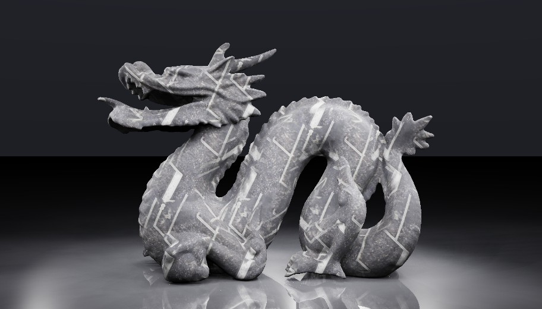 | 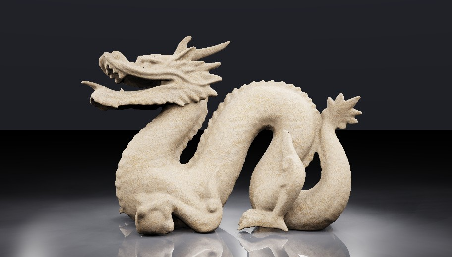 | 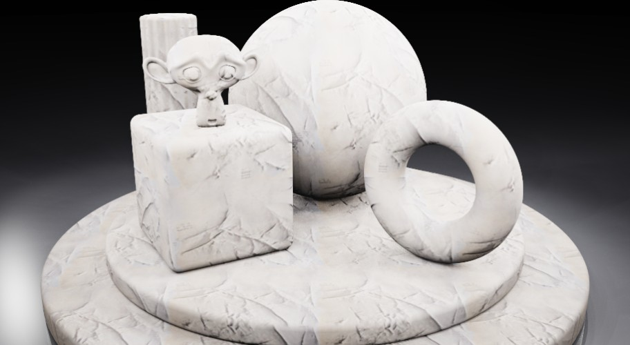 |
| 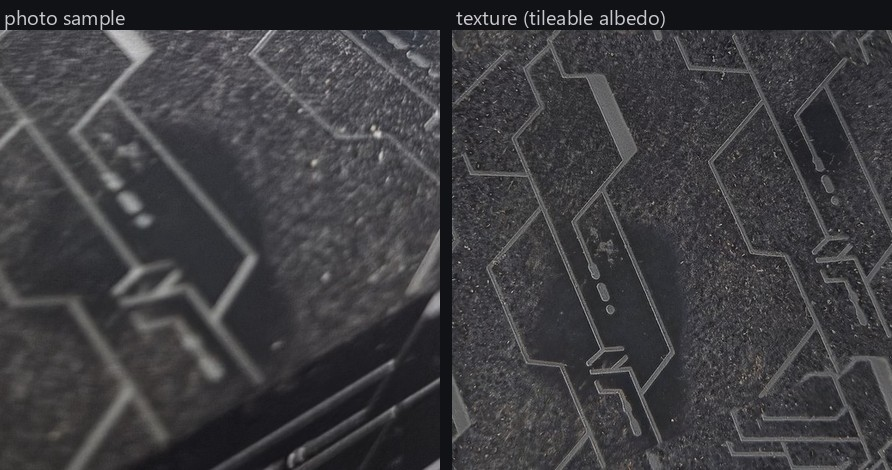 | 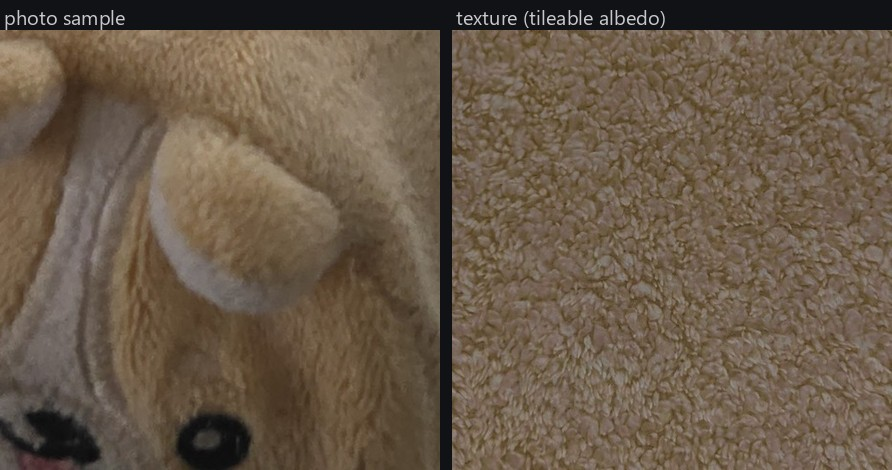 | 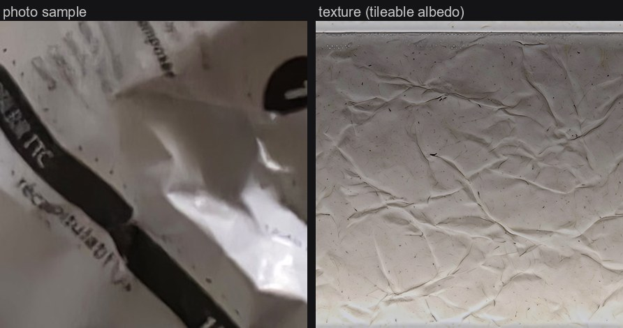 |
| 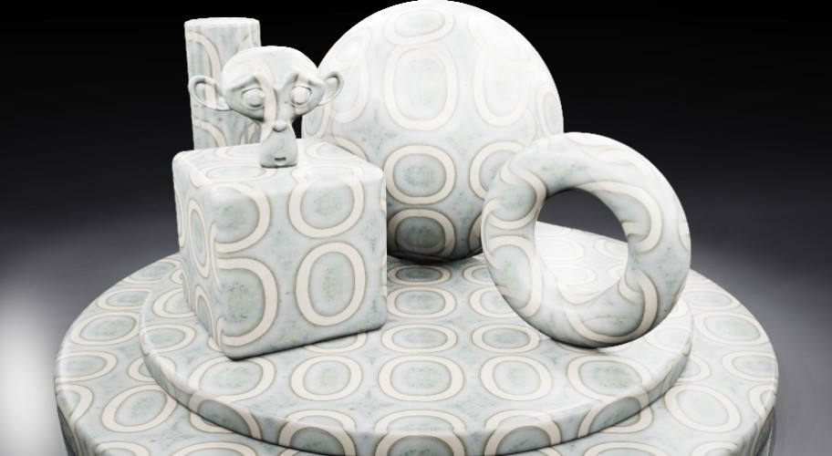 | 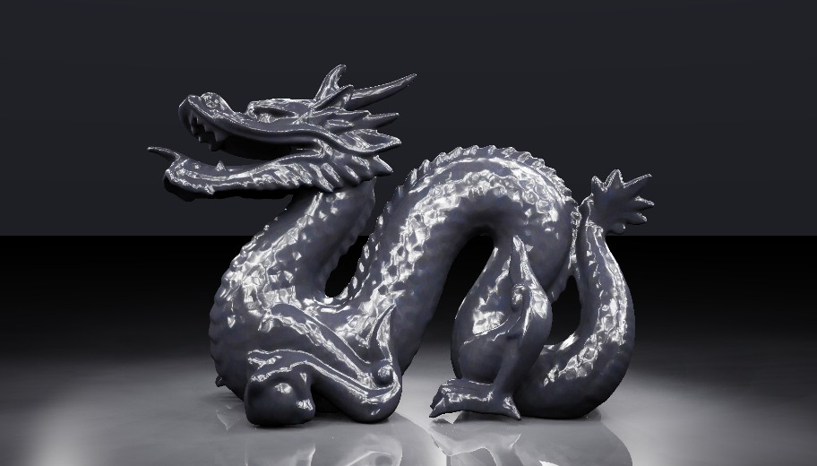 | 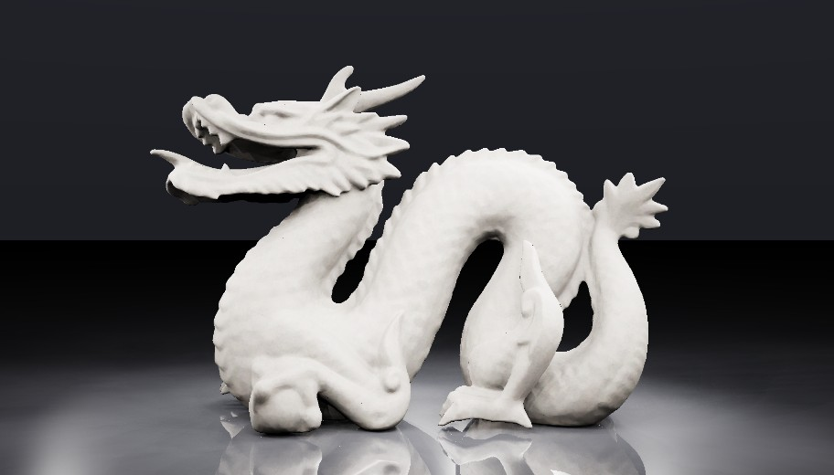 |
| 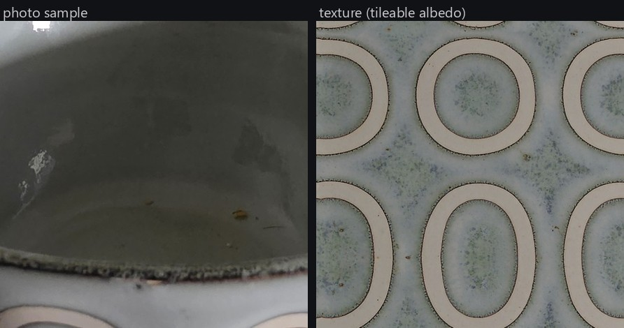 | 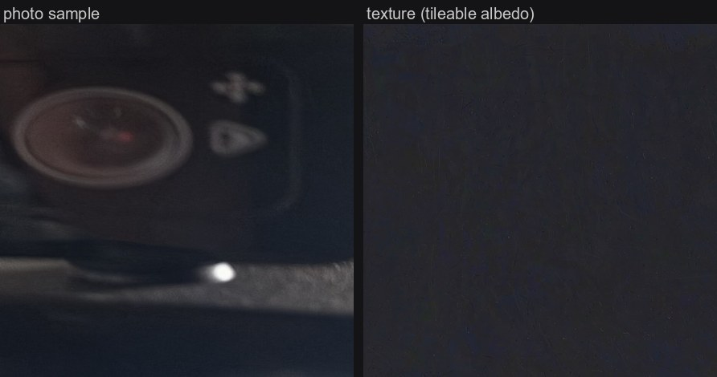 | 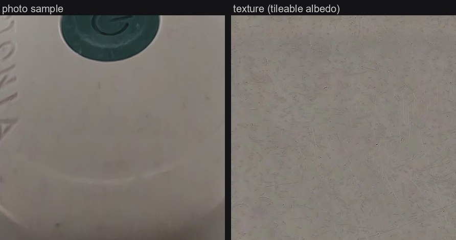 |

| Object | Spark understood · SAM found | Understand | Generate | Critique | Colour ΔE | Result |
|---|---|---|---|---|---|---|
| 3D-printed cube | black circuit cube · "box" | 34 s | 51 s | 93 s, 7 → 7, first kept | 2.4 → 0.8 | ✅ Circuit traces and print grain kept. Spark: the micro grain reads pitted, the photo is smooth |
| Plush | beige plush fabric · "plush toy" | 28 s | 53 s | 65 s, 4 → 6 | 43.2 → 17.3 | ✅ after the critique: relief like stone and too pale; colour matched to the warm tan, relief softened |
| Crumpled receipt | crumpled receipt paper · "crumpled paper" | 28 s | 56 s | 109 s, 3 → 7 | 35.6 → 14.2 | ✅ after the critique: a dark printed band formed grid lines when tiled; Muse repainted it as plain crumpled paper |
| Massager | matte white plastic · "white massager" | 29 s | 47 s | 78 s, 5 → 6 | 30.9 → 12.4 | ✅ after the critique: speckle, wear and a too-dark beige removed |
| Webcam | glossy black plastic · "webcam" | 34 s | 54 s | 73 s, 5 → 5 | 1.7 → 0.6 | ⚠️ Right colour, but Spark still finds it too matte and noisy for glossy plastic |
| Bowl | pale blue glazed ceramic · "bowl" | 39 s | 44 s | 113 s, 5 → 3, first kept | 46.4 → 18.5 | ⚠️ Muse copied the outside's oval rings into the plain glaze; Spark saw it, but its repaint scored worse, so the first version was kept |

**Time on the live site** (6 photos, median): understand 32 s (Spark's plan 21 s, SAM 2.5 s),
generate 52 s (Muse albedo 10 s, Muse height 12 s, pbrforge 9 s, the rest is saving to Vercel Blob),
critique 85 s, 1K export 14 s for an 8 to 19 MB zip. **From photo to a downloadable 1K material:
about 1.5 min; 3 min with the critique.** The same pipeline on a 4 GB container (Nov 2, 7 runs):
51 s, critique 55 s.

**What these runs taught, and what changed:**
- **"The main material" meant the largest surface (fixed).** On Nov 2, with no words, Spark took the
  glass table under the receipt. Spark was then taught to read the photo as its author framed it: the
  subject is what is centred, in focus, closest and standing out; the table or wall around it is
  context. It names the subject and says why, and the page shows it. On Nov 4, all six photos land on
  their object with no words at all, the receipt included.
- **The critique catches what the numbers miss.** A band repeated on both edges of the receipt passed
  the seam score (it compares opposite edges) and Spark saw it on the tiled view. A border-band check
  is the next metric to add.
- **Muse borrows patterns from elsewhere on the object.** The bowl's inside is a plain glaze; Muse
  took the ovals painted on its outside. On Nov 2 Spark's repaint fixed it (3 → 7/10, the version in
  the video); on Nov 4 the repaint scored worse and MatterLift kept the first. The comparison step is
  what keeps a bad fix from shipping.
- **Colour** after matching to the photo: ΔE under 1 on the dark objects, 12 to 18 on the pale ones,
  whose photos sit in dim, warm light.

## Built during the hackathon

Meta hackathon *Build for Your World*, Indie Developer track.

| | |
|---|---|
| First commit | 2026-11-01 18:57 (Paris) |
| Our code | Everything in this repository was written from 2026-11-01 onward; the Git history is the proof |
| Meta models (API) | Muse Spark 1.3, Muse Image 1.0, SAM 3.1, Muse Voice Transcribe 1.0 |
| Ported from Meta | `matterlift_api/sam_mask.py`: SAM mask decoder ported from `@meta-sam/parser` 0.1.0 (SAM License) |
| Quality reference | ambientCG Bricks113A (CC0), used locally as the benchmark and export-format model; not in the repository |
| Preview mesh | Ours: the material study, modelled from code in Blender 5.0 by `scripts/material_study.py` (MIT; Suzanne is Blender's own primitive), saved as `docs/blender/material_study.blend`, shipped as `web/public/models/material_study.ply`. No third-party mesh. Earlier versions used the Stanford scans (see `web/public/models/CREDITS.md`) |
| Libraries | numpy, SciPy, Pillow, FastAPI, Uvicorn, httpx, Pydantic, python-dotenv; Three.js, three-mesh-bvh (BVH build for Live RT), Vite, TypeScript |
| Live RT renderer | Ours, written during the hackathon in WebGPU/WGSL: started 2026-11-01 23:51 (Paris) as a standalone WebGPU prototype, shown in MatterLift from commit `3e5736c` (2026-11-02 01:21, Paris), and in this repository (`web/src/live/`, `live.html`) since commit `f345066` (2026-11-02 02:03, Paris). Its design comes from an offline NVIDIA OptiX/CUDA path tracer I wrote before the hackathon (ReSTIR direct lighting): its algorithms and parameters were ported from it into WGSL. No CUDA or OptiX code is in this repository; the WebGPU side (software BVH traversal, passes, shaders) was written during the hackathon |
| Runtime AI | **Meta models only**: Muse Spark, Muse Image, SAM 3.1 and Muse Voice Transcribe, through the Meta Model API (`https://api.meta.ai/v1`, the only AI endpoint the code calls). Checked in the code: `matterlift_api/`, `pbrforge/` and `web/src/` contain no call to any other AI provider or model (no OpenAI, Anthropic, Google Gemini, Hugging Face, Replicate, Stability or other service). pbrforge is plain numpy/SciPy; Live RT is our own renderer, on your GPU |
| Hosting | Vercel (page, API as a Python function, saved work in Vercel Blob) |
| Checked with | Godot 4.7, Blender 5.0, Khronos glTF Validator |

## How it works

With a photo, MatterLift works in two steps so you see what it understood before it paints:

1. **Understand** (about 30 s on the live site: Spark 21 s, SAM 2.5 s): Spark reads the request and the
   photo, SAM 3.1 masks the surface, and the UI shows the photo with the mask, the square that
   will be sampled and Spark's description.
2. **Generate** (about 50 s per material at 1K on the live site, in parallel for a room): Muse Image and pbrforge.

**Nothing fails alone.** Each step falls back to the next instead of stopping the run
(`matterlift_api/locate.py`, tested offline with failure injection in `tests/test_resilience.py`):

| If… | then… |
|---|---|
| the photo is a phone shot | EXIF rotation applied, resized to 2048 px; a non-image gets a clear 400 |
| Spark's plan has a wrong type or value | that field takes its default, numbers are clamped; invalid JSON is retried once |
| SAM finds nothing for Spark's name | Spark's alternative names, then Spark's points as a SAM prompt, then a sample around the points |
| the surface still cannot be located | the material is painted from Spark's description (and the UI says so) |
| Muse fails on the samples | Muse paints from the description |
| Muse fails on the height map | height from luminance |
| the Meta API answers 429/5xx or drops | up to two retries with backoff |
| anything else goes wrong | a readable error message, never a bare 500; one failed material never sinks a library |

**Samples** (`matterlift_api/sampling.py`): the largest rectangle inside the mask (aspect up to
3:1, so a countertop strip still gives a clean sample), then up to two more away from it (a floor
half hidden by furniture is better described by several samples). Muse gets all of them and is
told to keep the pattern scale of the first: the kitchen's octagonal floor tiles stay octagons.

<details>
<summary><b>Preview, the Study scene and Live RT</b>: render passes, look-dev controls, the path tracer and its limits, library mode</summary>

**Preview passes (AOVs)**: Beauty, Depth, Normal, Albedo, Roughness, AO, Thickness, with the height
map as real displacement on the mesh (so the depth pass shows the relief), and Save PNG for the
current pass.

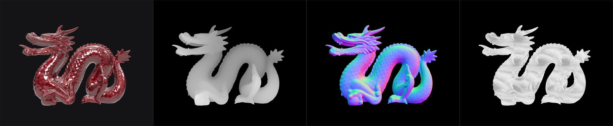
*"a ruby" on the Study: Beauty, Depth (white = near), Normal, Thickness (white = thick: the veins of
the stone).*

**Preview shapes and look-dev**: Sphere, Cube, Plane and the **Study**, MatterLift's own scene
(135k triangles, `scripts/material_study.py`): a two-step plinth (large flat areas, round edges), a
sphere (every angle at once), a rounded cube with Suzanne on it (flat faces, organic hollows), an
upright torus (concave and convex) and a fluted column (narrow grooves). It has UVs at the triplanar
density, whole tiles around the sphere, the torus and the cylinders, so displacement works on it and
the **Triplanar** switch compares both; in triplanar mode the relief is read along the world axes
too, under the pattern it belongs to. **Normal scale**, **Displacement scale**, **Tiling scale** and
**Clay render** (grey, no colour or metal, the relief stays) apply to every shape. **Real-world
scale** shows every shape 1 m across with one tile at the width Spark gives the material
(`tile_size_cm` in its plan: "a few planks of parquet 120 cm", "woven fabric 15 cm"), in the preview
and in Live RT. Sheen (fur, velvet, felt) takes the albedo's colour. A see-through material (glass, gem) shows the studio behind it, dimmed, so its refraction has
something to bend, with colour dispersion growing with its IOR.

<p align="center">
  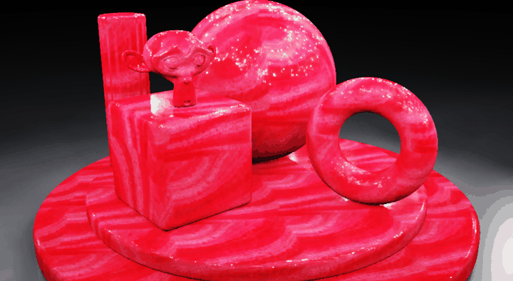
  <br>
  <sub><b>"a ruby"</b> in Live RT: path traced live in the browser (WebGPU ReSTIR, 256 lights). Not a video render: the page does this.</sub>
</p>

**Live RT**: the same material on the study (Sphere, Cube and Plane are greyed out while it is on),
path traced in the browser with WebGPU: unbiased ReSTIR DI (generalised RIS with pairwise MIS,
temporal and spatial reuse) over 256 white spot lights, or a three-point rig (key, fill, rim) for
judging a material; shadow rays through a BVH in compute shaders; GGX with metalness blended as it
is, the AO map as micro-shadowing, a Charlie sheen lobe; an SVGF denoiser that filters the lighting
alone (the texture stays sharp); accumulation with sub-pixel jitter (anti-aliased) that stops once
the image has converged. It renders at the size the canvas is shown at (up to 1080p) and is written
for any WebGPU GPU (plain WGSL, default limits, GPU timers only when offered): its *Auto* quality
aims at 60 FPS while the camera moves, with the cheaper unbiased variant then, and a lower resolution
if needed. The renderer is the `live.html` page of the same site (`web/src/live/`: `restir.js` for
the passes, `wgsl.js` for the shared WGSL, `main.js` for the scene), shown in an iframe over the
preview and fed the current maps, shading and model. Its HUD names the layers it does not trace
(transmission, clearcoat, anisotropy). Its unbiasedness is checked against an exact reference
(every light, one shadow ray each) by `live.html?test`: mean bias under 0.1 % (-0.08 % and -0.03 %
for the two unbiased variants, -6.9 % for the plain biased combination, over 128 frames on the
study). Normal scale, tiling, real-world scale and clay follow it; displacement does not (it traces
the mesh as it is).

<a id="live-rt-limits"></a>**Live RT limits** (an experimental viewer; the rest of MatterLift does not depend on it):

- **Tested on Chrome on Windows with an NVIDIA GPU only:** one machine, Windows 11, NVIDIA GeForce
  RTX 4060 (desktop), AMD CPU, in Chromium (Chrome and the Chromium of the Claude desktop app). Other
  browsers, systems and GPUs may work but are not verified. There it runs at 30-150 FPS depending on the
  variant and the zoom: about 27 ms per frame at 1080p for the visibility-in-target variant, 11 ms
  for the unshadowed-target one (bias test on the study), and well over 60 FPS while orbiting in the
  page, where it renders at the canvas's own size.
- **AMD GPU:** one remote test on a Radeon (RDNA 2) showed a corrupted image. The cause (integers stored
  in float lanes, which AMD may canonicalise) is fixed, but the fix has not been checked on an AMD
  GPU since.
- **Linux, Firefox, Safari, mobile: not tested.** WebGPU itself may be missing: on Linux, Chrome's
  WebGPU depends on the version and the GPU driver (it may need `chrome://flags`); Firefox and Safari
  ship WebGPU on some systems only. Without WebGPU the **Live RT** button is disabled and says why.
- **Laptops with two GPUs:** Chrome on Windows ignores the "high performance" request and may pick the
  integrated GPU; set Chrome to *High performance* in Windows graphics settings.
- **Weak or integrated GPUs** should settle at 540p or 360p (estimate from the costs measured on the
  RTX 4060). The renderer needs about 700 MB of GPU memory at 1080p and 170 MB at 540p; if allocation
  fails it steps down, and if the driver drops the GPU it asks for a reload.
- **Not a full material preview:** direct lighting only (no indirect bounce, no environment light), a
  mirror floor without shadows, and transmission, clearcoat, anisotropy, subsurface and displacement
  are not rendered (the HUD says which ones the current material uses).

**Library mode**: one photo of a room gives every material in it. Spark lists up to 8 materials
with two points on each; SAM masks each from its noun phrase (one concept per request, all in
parallel), Spark's points pick the right instance; then every sample is generated in parallel.
On a kitchen photo: 7 of 8 materials in 81 s. (Point prompts can segment 16 objects in one SAM
pass, but a point selects an object, one brick rather than the wall, so concept prompts win.)

- **Manual mode.** Click the surfaces you want on the photo before Generate, one material per click
  (Shift+click: more points on the same one). For each one Spark sees the photo with markers and
  plans the material under them; SAM then masks it, framed by Spark's noun phrase (the instance under
  your points) or, with *Spark frames the masks* off, as the object under the points.
- **Edit after Generate.** Click the photo in *What MatterLift understood* to add a material there;
  ↻ on a card then a click redoes that one; × removes it. Only the new or redone material is
  painted (`POST /libraries/{id}/items`, `DELETE /libraries/{id}/items/{index}`).

</details>

The whole chain, model by model, with what each one receives and answers: [How each Meta model works in MatterLift](#how-each-meta-model-works-in-matterlift).

<details>
<summary><b>pbrforge</b> (our numpy/SciPy code): what it fixes in Muse's output, the benchmark against a scanned material, the critique loop, the detail layer, colour fidelity</summary>

### pbrforge (pure numpy/scipy, no network)

What it fixes in raw Muse Image output, measured by `pbrforge.metrics`:

| Defect | Fix | Example (flagstone) |
|---|---|---|
| Muse returns a 1600 px image that repeats itself 2x2 (square blocks when tiled) | autocorrelation finds the period, keep one | period 800 found, cropped |
| Visible seams when tiled | Moisan periodic component (low-frequency mismatch) + Efros-Freeman minimum-error cut (structure) | seam score 1.49 -> 1.05 |
| Baked lighting, out-of-range albedo | delight (FFT low-pass gain) + PBR range fit | 1.9 % -> 0 % out of range |
| One standout feature that forms a grid when tiled | salient-blob detection, pulled toward the local colour | 6.6 % -> 2.6 % of the tile |
| Crinkled relief from luminance | height painted by Muse Image, low-frequency weighted bands, automatic joint polarity | see benchmark |

Benchmark against a reference material (ambientCG Bricks113A, derived from its Color map only,
`scripts/bench_baseline.py`):

| | luminance only (first version) | MatterLift |
|---|---|---|
| height vs reference displacement (r) | -0.24 | **0.71** |
| AO vs reference AO (r) | -0.07 | **0.65** |
| normal structure (r of X/Y components) | 0.12 | **0.50** (true displacement: 0.97) |
| normal fine detail vs reference | 0.34 (faces read smooth) | **0.80** |

Normals are built like a studio would: macro relief from Muse's height, micro detail (pores,
chisel marks, grain) from the albedo's fine band, which is exactly aligned with the colour, blended
with Reoriented Normal Mapping. Mean angular error is not the target: a flat normal map scores
8.0 deg on it, so it rewards smooth faces. Muse painting the normal map directly was tried and is
worse (r 0.34, wrong neutral colour).

**Spark critique** (`matterlift_api/critique.py`, `POST /materials/{id}/critique`, run
automatically after each generation). Spark reviews the material like a senior material artist: a
sphere under raking light, the 3x3 tiling and the photo sample. It scores it, lists what is wrong
and fixes it with the right tool: parameters (relief, roughness, wear, detail) are re-derived at
once, colour is matched to the photo deterministically, and only faults in the colour texture
itself (baked shadows, a standout feature, seams) go back to Muse for a repaint. Spark then compares
before and after side by side and the better one is kept. Live: walnut 4 -> 6, worn parquet 5 -> 7
(wear and detail raised, no new image), hammered copper 3 -> 6.

Lessons that shaped it: asked to judge a 3x3 tiling, Spark flags the repetition of the tile itself,
so the prompt says it is expected; two separate scores were too noisy (+-1), one A/B comparison is
steadier; and the word "tileable" in a repaint makes Muse lay copies side by side with visible
joins, which pbrforge now detects (evenly spaced joins and near-identical cells) and crops.

**Detail layer** (`pbrforge/detail.py`). What a studio adds on top of a scan: a procedural micro
relief (wood fibres and pores, stone grit and pits, fabric fuzz, brushed metal with scratches, plaster
sand), periodic so it tiles, repeated 8 times per texture and computed at the export resolution, so
a 4K export gets real 4K micro detail although Muse paints 1600 px. Blended into the normal with RNM
and into roughness. Wood fibres and metal brushing follow the local grain (structure tensor on the
albedo), so a parquet's vertical and horizontal boards each get fibres along their length. Plus edge wear: convex rims lighter and smoother, recesses darker and rougher.
Spark picks `detail_kind`, `detail_strength` and `wear` from the request ("very worn old parquet"
-> wood, 0.6, wear 0.85); the kind is inferred from the name when it does not say.

**Triplanar preview.** A Triplanar toggle projects every map along the world axes (whiteout blend
for normals): no UVs needed, no stretching at the sphere's poles, the same scale as the UVs.

**Colour fidelity.** Muse repaints the sample, so colours drift (a dusty terracotta comes back bright
orange). The albedo is matched to the delit photo samples in CIELAB, hue fully and lightness at 60%
(a sample in shadow says little about the true value). Delta E between mean colours, kitchen
materials: oak 10.7 -> 1.7, floor 37.1 -> 7.4, brick 13.9 -> 4.5. The UI shows sample and albedo
side by side with that score.

</details>

## Run it

Python 3.11+ and Node 20+. A Meta Model API key goes in `.env` (never committed). One command per
line, so it works the same in Windows PowerShell, Git Bash, macOS and Linux. On macOS and Linux,
write `.venv/bin/python` where it says `.venv/Scripts/python`.

```bash
git clone https://github.com/falcon123212/matterlift
cd matterlift
python -m venv .venv
.venv/Scripts/python -m pip install -e .
cp .env.example .env
npm --prefix web ci
npm --prefix web run build
.venv/Scripts/python -m uvicorn matterlift_api.main:app --port 8000
```

Then set `META_API_KEY` in `.env` and open http://localhost:8000: the API serves the built page
too, one server. Saved materials go to `data/`. To work on the page with hot reload, run
`npm --prefix web run dev` in a second terminal and open http://localhost:5173 (it forwards the API
calls to port 8001: start uvicorn with `--port 8001`).

Checks: `.venv/Scripts/python scripts/smoke_meta.py` (every Meta model answers, needs the key);
`.venv/Scripts/python -m pip install -e .[dev]` then `.venv/Scripts/python -m pytest -q` (offline
tests, no key; the Godot ones run when `GODOT_BIN` points at a Godot 4 binary).

API:
- `POST /understand` (form: `photo`, optional `text`, `audio`): step 1, returns the plan, overlay and sample.
- `POST /materials` (form: `understanding` id, or `text`/`audio` with optional `photo`; `size`): a material.
- `POST /libraries` (form: `photo`, optional `text`, `audio`; manual mode: `points` as JSON
  `[[[x, y], ...], ...]` in 0..1000, one group per material, and `frame` true/false): library step 1;
  then `POST /libraries/{id}/build` (form: `size`) generates every material that has none yet.
- `POST /libraries/{id}/items` (form: `points` with one group, `frame`, optional `index` to redo
  that item) and `DELETE /libraries/{id}/items/{index}`: edit a library.
- `GET /materials/{id}`, `/materials/{id}/maps/{name}.png`, `/materials/{id}/export?size=2048&fmt=png`,
  `GET /libraries/{id}`. The UI reopens them with `?id=` or `?lib=`.

## Tests and benchmarks

191 offline tests (no Meta key, no network) run on every push in GitHub Actions, with Godot and the
formats' official validators installed:

| What | How it is checked |
|---|---|
| Every export the UI offers | 512, 1K, 2K, 4K × PNG, JPG: every file present and named like ambientCG, sizes, pixel formats (16-bit displacement), albedo in PBR range, unit normals facing out, DirectX normal = OpenGL with green flipped, **every map tiles without a seam**, zip complete, `.glb` textures at full size (`tests/test_export_matrix.py`) |
| glTF | **Khronos glTF-Validator**: 0 errors, 0 warnings on 14 packages (every shading lobe: clearcoat, sheen, transmission + IOR, anisotropy, subsurface, all at once; metal and not), including the thickness texture of KHR_materials_volume |
| MaterialX | **MaterialX library (ASWF)**: documents validate, one OpenPBR surface, every texture file exists |
| USD | **Pixar USD**: stages open, UsdPreviewSurface with its 5 inputs connected, every texture asset resolves |
| Godot 4.7 | **Godot headless** opens the 14 packages: the `.tres` with all its textures, the live shader **compiles** (its controls are exposed), the `.glb` loads through GLTFDocument (`tests/test_export_godot.py`) |
| What users upload | Through the HTTP API: JPEG, PNG with transparency, palette PNG, 16-bit PNG, greyscale, CMYK JPEG, WebP, rotated phone photo, 24 px, 6000 px, 4000×300 panorama → a material; empty, truncated, non-image, 31 MB upload, decompression bomb → a clear 400/413; WAV speech, silence, non-WAV audio; path traversal and bad ids → 404 (`tests/test_api_inputs.py`) |
| Model failures | Spark garbage or empty answers, SAM misses, Muse failures: a material still comes out (`tests/test_resilience.py`) |
| Performance | Time and memory guards per size (`tests/test_perf.py`); the 4K export must fit the API container |

The validators were checked against broken files (a wrong MaterialX type, a missing USD texture, a
corrupted `.glb` count, a shader with an unknown identifier): each one fails as it should.

These tests found a real bug: 2K and 4K exports had a seam at the tile border, because the resize
(Pillow's Lanczos) clamps at the image edge instead of wrapping. Maps are now padded with their own
opposite edges before resizing (`pbrforge/io.py`); the seam score went from 3.98 to 1.07 (1 = invisible).

**Export report on a real material** (`scripts/export_report.py`, full table in
[`results/export_report.md`](results/export_report.md)): "old red brick", generated by MatterLift,
exported the way the download button does it at 512, 1K, 2K, 4K × PNG, JPG, plus every shading lobe:
**14 of 14 packages pass glTF-Validator, MaterialX, USD and Godot**. A 4K PNG package (maps recomputed
at 4K, 20 files) takes 76 s and zips to 203 MB; 1K takes 5 s and 17 MB.
The 512 PNG package, unzipped, is in [`samples/export/OldRedBrick_512-PNG`](samples/export/OldRedBrick_512-PNG):
drop the folder into a Godot project, open the `.glb` in Blender, or load the `.mtlx` / `.usda`.

**pbrforge performance** (`scripts/bench_pbrforge.py`, full table in `results/perf_pbrforge.md`), from a
1600 px albedo (Muse Image's size), on a desktop AMD CPU (12 threads):

| Size | Maps (s) | Peak memory | Export + zip, PNG (s) | Zip, PNG / JPG |
|---|---|---|---|---|
| 512 | 0.35 | 46 MB | 0.8 | 6 / 5 MB |
| 1K | 1.3 | 122 MB | 2.1 | 20 / 15 MB |
| 2K | 5.5 | 487 MB | 7.8 | 66 / 47 MB |
| 4K | 24.7 | 2.5 GB | 31 | 224 / 149 MB |

A 4K export needs about 2.5 GB, within the 4 GB of the API container; two at the same moment would
likely not fit (not measured yet: that is for the load test), so 4K exports are best done one at a time.

## Deploy

<details>
<summary>How it is deployed on Vercel's free plan, and how to deploy your own</summary>

One Vercel project (free Hobby plan) serves the page and the API:

- **The page** is built by Vercel (`vercel.json`: `npm --prefix web ci`, build, then
  `web/scripts/check-dist.mjs` refuses an unbuilt page) and served from its CDN.
- **The API** is the same FastAPI app as on a PC, one Python function (`pyproject.toml`:
  `[tool.vercel] entrypoint = "matterlift_api.main:app"`, up to 300 s per request).
- **Saved work** (materials, understandings, libraries) goes to **Vercel Blob**, since a function's
  disk does not outlive the request: `matterlift_api/storage.py` mirrors each saved folder (files
  under their content hash, one manifest per save) and pulls it back on any instance. Images and
  `.zip` exports are redirects to Blob, as a function answers at most 4.5 MB. Old folders are
  purged to stay under the free 1 GB. Without a Blob store (a PC, a server) none of this runs.
- **Free-plan limits**: 2 GB of memory, so materials and exports stop at 2K there (4K locally);
  the page shrinks photos to 2048 px before upload (4.5 MB request limit).

Setting it up, once:

1. https://vercel.com/new: import the GitHub repository (Vercel detects FastAPI and reads
   `vercel.json`). Every push then redeploys.
2. Storage → Create → **Blob**, access **Public**, and connect it to the project (this adds
   `BLOB_STORE_ID`).
3. Settings → Environment Variables: the `META_*` values from `.env.example`, with your key in
   `META_API_KEY`. Then redeploy.

`VITE_LIVE_URL` points **Live RT** at another copy of the WebGPU renderer (default: `live.html` of the same site).

</details>

## Export

<details>
<summary>Every file of the package, and which shading lobes go into which format</summary>

Same layout as an ambientCG package (checked against Bricks113A_4K-JPG), recomputed at the
requested resolution (512 to 4K) from the clean albedo and the Muse height:

```
RustyPaintedSteel_2K-PNG/
  RustyPaintedSteel_2K-PNG_Color.png          sRGB albedo
  RustyPaintedSteel_2K-PNG_NormalGL.png       OpenGL normal (Godot, Blender, Unity)
  RustyPaintedSteel_2K-PNG_NormalDX.png       DirectX normal (Unreal)
  RustyPaintedSteel_2K-PNG_Roughness.png
  RustyPaintedSteel_2K-PNG_AmbientOcclusion.png
  RustyPaintedSteel_2K-PNG_Displacement.png   16-bit PNG
  RustyPaintedSteel_2K-PNG_Metalness.png      only when the material has metal
  RustyPaintedSteel_2K-PNG_Thickness.png      only when light goes in or through (subsurface, transmission)
  RustyPaintedSteel_2K-PNG.tres               Godot 4 StandardMaterial3D
  RustyPaintedSteel_2K-PNG.mtlx               MaterialX OpenPBR
  RustyPaintedSteel_2K-PNG.usda               USD UsdPreviewSurface
  RustyPaintedSteel_2K-PNG.glb                glTF 2.0, textures embedded, on a preview sphere
  shader/                                      live controls instead of baked ones:
    RustyPaintedSteel_2K-PNG.gdshader          Godot 4 shader: tiling, relief, detail, wear, triplanar sliders
    RustyPaintedSteel_2K-PNG_shader.tres       ShaderMaterial with its textures assigned
    RustyPaintedSteel_2K-PNG_blender.py        Blender 4/5: builds the node tree, Value nodes are the controls
    *_ShaderColor/Normal/ORM, _WearMask, _DetailNormal, _DetailHeight   clean layers they recombine
  RustyPaintedSteel.png                       preview sphere
```

Spark's shading model goes into every format that has it: KHR_materials_clearcoat, _transmission,
_ior, _sheen, _anisotropy and _diffuse_transmission (for subsurface) in the `.glb`; clearcoat,
anisotropy, subsurface scattering, rim (for sheen) and specular (for IOR) in the `.tres`; coat,
transmission, fuzz, subsurface, anisotropy and IOR in the OpenPBR `.mtlx`; clearcoat and IOR in the
`.usda`.

Skin, wax, jade, glass or ruby also get a **thickness map**: how much matter light crosses, white =
thick. A photo cannot measure it, so it follows the broad relief: raised masses are thick, hollows thin,
pores and scratches leave it alone (a flat skin stays evenly thick instead of blotchy). It goes in the
`.glb` as KHR_materials_volume (thickness tinted by the albedo), in the `.tres` as subsurface
transmittance, and in the `.mtlx` as OpenPBR's subsurface radius and transmission depth.
UsdPreviewSurface has no such input. The page shows it as the **Thick** render pass.

The `shader/` folder keeps the studio controls live: the base maps without detail or wear, one
detail tile and a wear/grain mask (edges, cavities, grain direction), recombined by a Godot shader and
a Blender node tree with the same maths as pbrforge, so the defaults match the baked textures and
tiling, relief, detail and wear stay sliders.

Verified:
- the Godot shader compiles in Godot 4.7.2 and renders as the baked `.tres` at its defaults, with
  wear, detail and triplanar on a cube changing as expected;
- the Blender script runs in Blender 5.0 (31 nodes, colour mixes on their colour sockets) and
  renders in Cycles ([▶ watch it in Blender](https://youtu.be/5K5PUd57xCg));
- the `.glb` passes the Khronos glTF Validator with 0 errors and 0 warnings, including a material
  with five KHR extensions;
- Three.js loads it as a MeshPhysicalMaterial with every map and every extension value;
- Godot 4.7.2 loads the `.glb` (maps, tiling from KHR_texture_transform) and the `.tres`, next to
  the reference package. Godot's glTF importer ignores clearcoat and anisotropy, so for Godot the
  `.tres` is the file that carries them. [▶ Watch the package in Godot](https://youtu.be/tEU3NPhObLY).

Scripts: `smoke_meta.py` (every model answers), `gate_muse.py` (3 materials, raw vs MatterLift
contact sheet), `sam_table.py` (photo chain), `library_sheet.py` (a library's masks and spheres),
`bench_baseline.py` (against a reference material).

</details>

## Meta Model API notes (docs: https://dev.meta.ai/docs)

<details>
<summary>What we learned about the Meta Model API</summary>

- Base URL `https://api.meta.ai/v1`, OpenAI-compatible. Model ids: `muse-spark-1.3`,
  `muse-image-1.0`, `sam-3.1`, `muse-voice-transcribe-1.0`.
- Spark is a reasoning model: give it `max_completion_tokens` in the thousands or `content` is empty.
- Muse Image returns 1600x1600 whatever `size` says (it sets the aspect ratio); `/images/edits` has no
  `mask` field. We ask for PNG and `reasoning_strength: "low"`: twice as fast (~9 s), and it paints a
  unique 1600 px image, where `"high"` repeats one 800 px tile 2x2 (half the usable resolution).
  Height maps are as good in low (r 0.60 vs 0.60 against the reference displacement).
- Muse Voice Transcribe: `POST /v1/asr/transcribe` (not the OpenAI route), multipart `request` (JSON)
  + `audio`, WAV mono 16-bit at 16/24 kHz only. The browser converts its WebM recording to 24 kHz WAV;
  the API normalises any WAV and biases recognition with material vocabulary (`keywords`).
- SAM 3.1 answers on `/responses` only, as text: a box token and a mask token per instance. We
  request `metadata.mask_encoding: "one_bit"` and decode it in `matterlift_api/sam_mask.py`, a
  Python port of Meta's `@meta-sam/parser` decoder (adaptive binary range coder, 12-bit context).

</details>

## Credits

Concept, product design, UI design and build plan: Silver (falcon123212).
Implementation written with Claude Code (Anthropic) as a coding assistant, under my direction:
I chose the pipeline, reviewed the code, ran the tests and validated the materials in the results
gallery. Claude Code was used to write code during development only: it is never called when
MatterLift runs, where the only AI models are Meta's (see *Runtime AI* in
[Built during the hackathon](#built-during-the-hackathon)).
Meta models: Muse Spark, SAM 3.1, Muse Image, Muse Voice Transcribe.
3D model: the material study is ours (`scripts/material_study.py`, MIT). Earlier versions and short videos
show the Stanford Dragon, Happy Buddha and Lucy from the Stanford 3D Scanning Repository, Stanford
University Computer Graphics Laboratory (https://graphics.stanford.edu/data/3Dscanrep/), used under
its terms (non-commercial, source acknowledged); the meshes are no longer in the repository. See
`web/public/models/CREDITS.md`.
Third-party code, data and libraries: see [Built during the hackathon](#built-during-the-hackathon).

## License

MIT (see `LICENSE`), except `matterlift_api/sam_mask.py`, a port of Meta's `@meta-sam/parser`,
which is distributed under the SAM License (see `LICENSE-SAM`). The material study in
`web/public/models/` is MIT like the rest.
